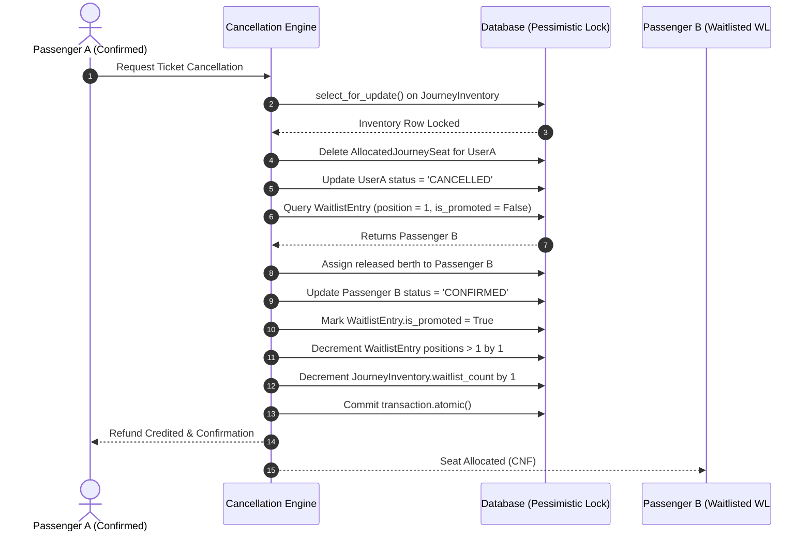

# RailConnect – Cancellation Refund & Waitlist Promotion Rules

## 1. Cancellation Policy & Tiered Refund Matrix

RailConnect features a rule-based refund system modeled on Indian Railways (IRCTC) passenger cancellation rules, simplified and transparently documented for college viva examination.

### 1.1 Time-Window Refund Tiers

$$\text{Hours Before Departure} = \frac{\text{Departure Timestamp} - \text{Cancellation Request Timestamp}}{3600}$$

| Window Before Scheduled Departure | Refund Percentage | Clerkage / Cancellation Fee Retained | Status Flag |
| :--- | :--- | :--- | :--- |
| **Tier 1: Greater than 48 Hours** | **90% Refund** | **10% Clerkage Charge** | `REFUND_TIER_FULL` |
| **Tier 2: Between 12 and 48 Hours** | **50% Refund** | **50% Cancellation Fee** | `REFUND_TIER_PARTIAL` |
| **Tier 3: Less than 12 Hours** | **0% Refund (Nil)** | **100% Fee Retained** | `REFUND_TIER_NON_REFUNDABLE` |

### 1.2 Mathematical Example
- **Ticket Fare**: ₹1,000 for 1 passenger.
- **Scenario A (Cancelled 72 hours before journey)**:
  - $\text{Refund Amount} = ₹1000 \times 0.90 = ₹900$
  - $\text{Clerkage Fee} = ₹1000 - ₹900 = ₹100$
- **Scenario B (Cancelled 20 hours before journey)**:
  - $\text{Refund Amount} = ₹1000 \times 0.50 = ₹500$
  - $\text{Fee Deducted} = ₹500$
- **Scenario C (Cancelled 4 hours before journey)**:
  - $\text{Refund Amount} = ₹0$
  - $\text{Fee Deducted} = ₹1,000$

---

## 2. Waitlist Auto-Promotion Engine (FIFO Queue)

When a confirmed passenger cancels their seat, manual administrator intervention is **not required**. The engine automatically reclaims the seat and promotes the next eligible waitlisted passenger.

### 2.1 Promotion Workflow



### 2.2 Queue Shift Mechanics
If 3 passengers are in the waitlist:
- Passenger B: `position = 1`
- Passenger C: `position = 2`
- Passenger D: `position = 3`

Upon cancellation of a confirmed seat:
1. Passenger B is promoted to **Confirmed** and receives the coach berth.
2. Passenger C's queue position shifts: $2 - 1 = 1$ (`WL #1`).
3. Passenger D's queue position shifts: $3 - 1 = 2$ (`WL #2`).
4. Total `waitlist_count` in inventory decrements from 3 to 2.

---

## 3. Concurrency Safety & Race Condition Defense

### 3.1 Pessimistic Database Locking
In high-traffic reservation windows (e.g. Tatkal rush), multiple users may request the last seat simultaneously:

```python
with transaction.atomic():
    inventory = JourneyInventory.objects.select_for_update().get(
        train=train, journey_date=journey_date, class_code=class_code
    )
    if inventory.available_seats >= passenger_count:
        # Allocate concrete berths
    else:
        # Place in waitlist
```
`select_for_update()` issues an SQL `SELECT ... FOR UPDATE` clause, locking the row until the transaction commits or rolls back. Other threads queue behind this lock, guaranteeing strictly serialized execution.

### 3.2 Physical Constraint Defense
Even if application logic were somehow bypassed, the database layer enforces:
```python
models.UniqueConstraint(
    fields=['seat', 'journey_date'],
    name='unique_seat_per_journey_date'
)
```
Any accidental duplicate seat allocation immediately triggers an `IntegrityError` rollback, preventing corrupted inventory state.
