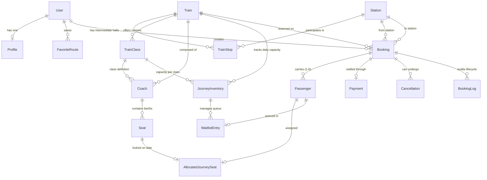

# RailConnect – Entity Relationship Diagram & Database Schema

## 1. Mermaid Entity-Relationship Diagram

---

## 2. Relational Schema & Tables Reference

### 2.1 Accounts Domain
- **`accounts_profile`**:
  - `id` (PK, Auto)
  - `user_id` (FK to `auth_user`, Unique, 1-to-1)
  - `phone_number` (VARCHAR 15)
  - `id_proof_type` (VARCHAR 20)
  - `id_proof_number` (VARCHAR 30)
  - `address`, `city`, `state`, `pincode`
- **`accounts_favoriteroute`**:
  - `id` (PK)
  - `user_id` (FK to `auth_user`)
  - `from_station_id` (FK to `trains_station`)
  - `to_station_id` (FK to `trains_station`)
  - Unique Constraint: `(user_id, from_station_id, to_station_id)`

### 2.2 Trains Domain
- **`trains_station`**:
  - `id` (PK)
  - `code` (VARCHAR 10, Unique, Uppercase, Indexed)
  - `name`, `city`, `state`, `zone`
- **`trains_train`**:
  - `id` (PK)
  - `train_number` (VARCHAR 10, Unique, Indexed)
  - `name` (VARCHAR 150)
  - `train_type` (VARCHAR 20)
  - `source_station_id` (FK to `trains_station`)
  - `destination_station_id` (FK to `trains_station`)
  - `departure_time`, `arrival_time` (TIME)
  - `runs_on_days` (VARCHAR 50)
  - `distance_km` (INT)
- **`trains_trainstop`**:
  - `id` (PK)
  - `train_id` (FK to `trains_train`)
  - `station_id` (FK to `trains_station`)
  - `stop_order` (INT)
  - `arrival_time`, `departure_time` (TIME)
  - `halt_minutes` (INT)
  - `distance_from_source_km` (INT)
  - `day_offset` (INT)
  - Unique Constraints: `(train_id, stop_order)` and `(train_id, station_id)`
- **`trains_trainclass`**:
  - `id` (PK)
  - `train_id` (FK to `trains_train`)
  - `class_code` (VARCHAR 5)
  - `base_fare`, `per_km_rate` (DECIMAL)
  - `total_coaches`, `seats_per_coach` (INT)
  - Unique Constraint: `(train_id, class_code)`

### 2.3 Bookings & Concurrency Domain
- **`bookings_coach`**:
  - `id` (PK), `train_id` (FK), `coach_code` (VARCHAR 10), `travel_class` (VARCHAR 5), `total_seats` (INT)
  - Unique Constraint: `(train_id, coach_code)`
- **`bookings_seat`**:
  - `id` (PK), `coach_id` (FK), `seat_number` (INT), `berth_type` (VARCHAR 20)
  - Unique Constraint: `(coach_id, seat_number)`
- **`bookings_journeyinventory`**:
  - `id` (PK), `train_id` (FK), `journey_date` (DATE), `class_code` (VARCHAR 5)
  - `total_seats`, `booked_seats`, `available_seats`, `waitlist_count`, `max_waitlist` (INT)
  - Unique Constraint: `(train_id, journey_date, class_code)`
- **`bookings_booking`**:
  - `id` (PK)
  - `pnr` (VARCHAR 10, Unique, Indexed)
  - `user_id` (FK), `train_id` (FK), `from_station_id` (FK), `to_station_id` (FK)
  - `journey_date` (DATE), `class_code` (VARCHAR 5), `status` (VARCHAR 25)
  - `total_fare` (DECIMAL), `contact_email`, `contact_phone`
- **`bookings_passenger`**:
  - `id` (PK), `booking_id` (FK), `name`, `age`, `gender`, `berth_preference`
  - `status` (CONFIRMED / WAITLISTED / CANCELLED)
  - `allocated_seat_id` (FK to `bookings_seat`, Nullable)
  - `waitlist_number` (INT, Nullable), `fare` (DECIMAL)
- **`bookings_allocatedjourneyseat`**:
  - `id` (PK), `seat_id` (FK), `journey_date` (DATE), `passenger_id` (FK), `booking_id` (FK)
  - **Unique Constraint: `(seat_id, journey_date)`** &larr; Physical prevention of double allocation
- **`bookings_waitlistentry`**:
  - `id` (PK), `booking_id` (FK), `passenger_id` (FK, Unique), `inventory_id` (FK), `position` (INT), `is_promoted` (BOOL)
- **`bookings_cancellation`**:
  - `id` (PK), `booking_id` (FK), `cancelled_passengers_count`, `original_fare`, `cancellation_fee`, `refund_amount`, `refund_status`
- **`bookings_bookinglog`**:
  - `id` (PK), `booking_id` (FK), `action` (VARCHAR 50), `description` (TEXT), `created_at` (TIMESTAMP)

### 2.4 Payments Domain
- **`payments_payment`**:
  - `id` (PK), `booking_id` (FK), `transaction_id` (VARCHAR 64, Unique, Indexed)
  - `amount` (DECIMAL), `payment_method` (VARCHAR 30), `status` (VARCHAR 20), `failure_reason`

---

## 3. Database Normalization Analysis
1. **First Normal Form (1NF)**:
   - All table attributes are atomic. No repeating groups (passenger lists are stored as individual rows in `Passenger`, not JSON or comma-separated strings).
2. **Second Normal Form (2NF)**:
   - All non-key attributes are fully functionally dependent on primary keys. Route stops are decomposed into `TrainStop` linked by foreign keys rather than redundant columns on `Train`.
3. **Third Normal Form (3NF)**:
   - Zero transitive dependencies. Fare computation formulas are calculated deterministically from `TrainClass` and station distance offsets. Station attributes (`city`, `state`, `zone`) reside strictly in `Station` without duplication in bookings or timetable tables.
